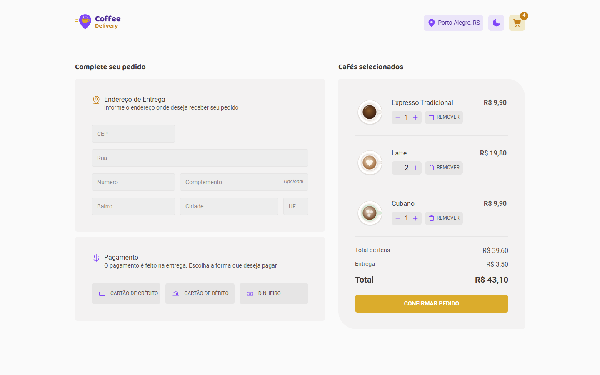
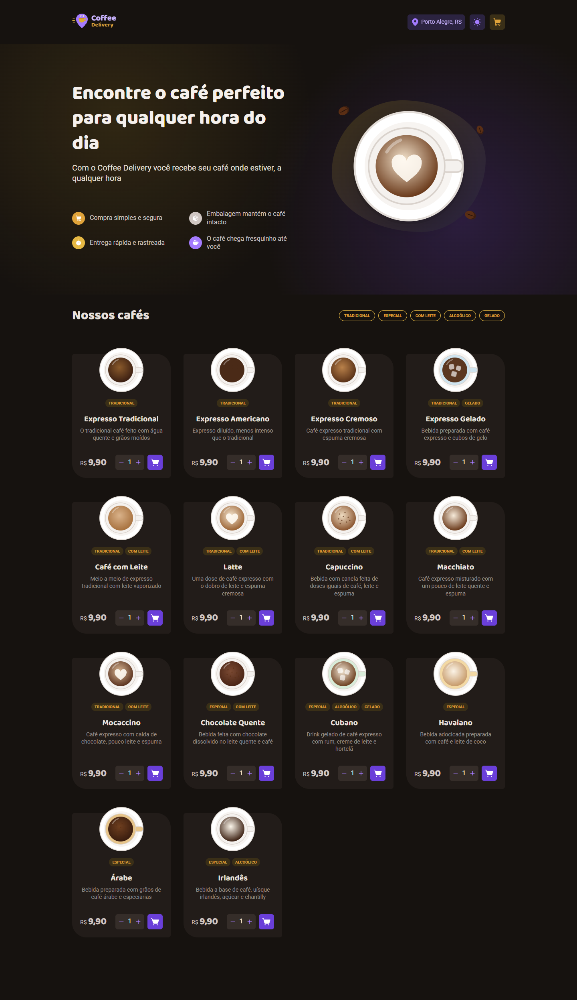
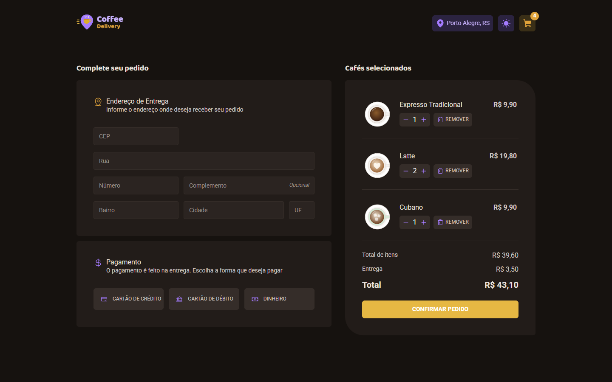
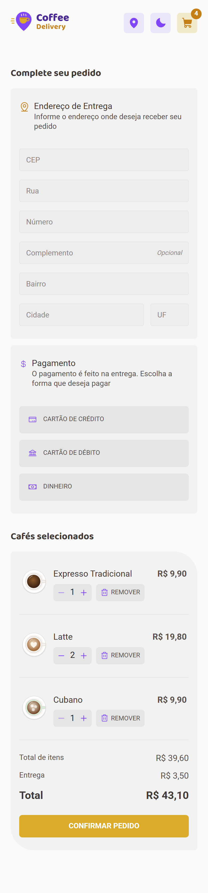
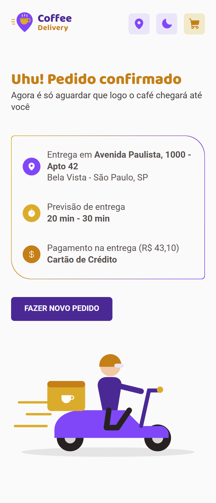
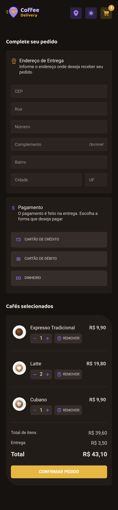
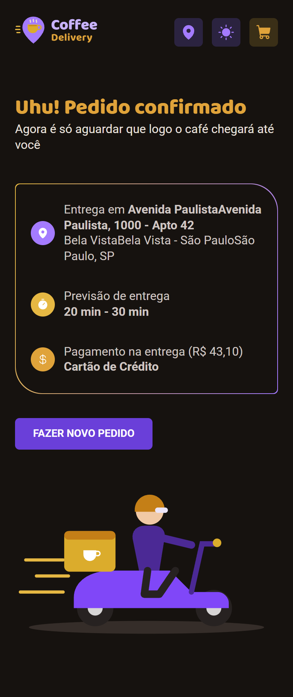
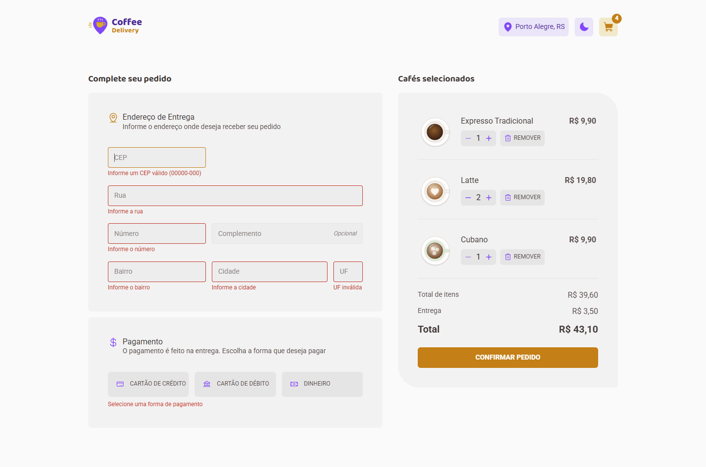

<p align="center">
  
</p>

<h1 align="center">Coffee Delivery ☕</h1>

<p align="center">
  SPA de e-commerce de uma cafeteria fictícia, feita com <b>React + Vite + TypeScript</b>.<br/>
  Projeto final de React — <b>Luiz Felipe Rodrigues Silva</b>
</p>

<p align="center">
  <a href="__DEPLOY_URL__"><b>🔗 Acessar aplicação publicada</b></a>
</p>

---

## 📌 Sobre

O usuário navega por um catálogo de 14 cafés, adiciona itens ao carrinho, altera quantidades, informa o endereço de entrega, escolhe a forma de pagamento e finaliza um pedido fictício. O projeto segue o protótipo do Figma e acrescenta **Dark Mode**, **responsividade completa**, **logo original criada com IA**, filtros por categoria e autopreenchimento de endereço pelo CEP.

## ✨ Funcionalidades

- Catálogo com 14 cafés, filtros por categoria e seletor de quantidade
- Carrinho global (Context API + `useReducer`) persistido no **LocalStorage**
- Checkout com **React Hook Form + Zod** (mensagens de erro por campo, máscara de CEP)
- Autopreenchimento do endereço via **ViaCEP**
- Cálculo de total dos itens + entrega (R$ 3,50) em tempo real
- Página de confirmação do pedido e página 404
- **Light/Dark Mode** com preferência salva e respeito ao tema do sistema
- Layout responsivo para **desktop, tablet e mobile**
- Acessibilidade: HTML semântico, `aria-label`, foco visível, navegação por teclado

## 🛠️ Tecnologias

React 19 · Vite 7 · TypeScript · React Router 7 · Context API · useReducer · React Hook Form · Zod · CSS Modules · Phosphor Icons · Vitest · Testing Library · ESLint · Puppeteer · Vercel

## 🚀 Como executar

Pré-requisito: **Node.js 20+**.

```bash
git clone __REPO_URL__.git
cd coffee-delivery
npm install
npm run dev        # http://localhost:5173
```

| Script | Descrição |
|--------|-----------|
| `npm run dev` | Servidor de desenvolvimento |
| `npm run build` | Checagem de tipos + build de produção |
| `npm run preview` | Pré-visualiza o build |
| `npm test` | Executa os 35 testes |
| `npm run test:coverage` | Testes com cobertura |
| `npm run lint` | ESLint |
| `npm run screenshots` | Gera as evidências em `docs/screenshots` (com `npm run dev` ativo) |

## 🗂️ Documentação

| Documento | Conteúdo |
|-----------|----------|
| [PRD_SPEC.md](PRD_SPEC.md) | Produto, requisitos funcionais e não funcionais, regras de negócio, critérios de aceite |
| [TECH_SPEC.md](TECH_SPEC.md) | Arquitetura, tecnologias, componentes, gerenciamento de estado, testes |
| [TASKS_SPEC.md](TASKS_SPEC.md) | Planejamento e acompanhamento das tarefas |
| [AGENTS.md](AGENTS.md) | Diretrizes e registro de uso do assistente de IA |

## 🏗️ Arquitetura (resumo)

```
ThemeProvider → CartProvider (useReducer + LocalStorage) → BrowserRouter → DefaultLayout
  ├─ /          Home      (catálogo + filtros)
  ├─ /checkout  Checkout  (React Hook Form + Zod + resumo do carrinho)
  ├─ /success   Success   (confirmação do pedido)
  └─ *          NotFound
```

Detalhes em [TECH_SPEC.md](TECH_SPEC.md).

## 🖼️ Evidências

### Desktop — Light Mode

| Home | Checkout | Sucesso |
|------|----------|---------|
|  |  |  |

### Desktop — Dark Mode

| Home | Checkout | Sucesso |
|------|----------|---------|
|  |  |  |

### Mobile (390px)

| Home (light) | Checkout (light) | Sucesso (light) | Home (dark) | Checkout (dark) | Sucesso (dark) |
|---|---|---|---|---|---|
|  |  |  |  |  |  |

### Tablet e validação do formulário

| Tablet (820px) | Validação com Zod |
|---|---|
|  |  |

### Testes

```
 ✓ src/reducers/cart/reducer.test.ts (14 tests)
 ✓ src/utils/format.test.ts (3 tests)
 ✓ src/schemas/checkout.test.ts (8 tests)
 ✓ src/test/app.test.tsx (10 tests)

 Test Files  4 passed (4)
      Tests  35 passed (35)
```

## 🤖 Uso de Inteligência Artificial

O projeto foi desenvolvido com o apoio do **Claude Code (Anthropic)** em todas as fases: planejamento (specs), criação da **logo original**, implementação, revisão de código, testes e depuração. O registro completo — fases, prompts, o que foi verificado e as diretrizes para agentes — está em [AGENTS.md](AGENTS.md).

**Logo:** pin de localização (entrega) com uma xícara fumegante (café) e linhas de velocidade (entrega rápida), nas cores roxo e amarelo do protótipo. Gerada por IA em SVG — ver [AGENTS.md §6](AGENTS.md#6-logo-criada-com-ia).

## 👤 Autor

**Luiz Felipe Rodrigues Silva**

Protótipo de referência: [Figma — Coffee Delivery](https://www.figma.com/design/yGPNTA0Yczb183EikXGIiA/Coffee-Delivery-%E2%80%A2-Projeto-Final-React?node-id=2-1297)
