<p align="center">
  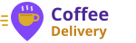
</p>

<h1 align="center">Coffee Delivery ☕</h1>

<p align="center">
  SPA de e-commerce de uma cafeteria fictícia com <b>React + Vite + TypeScript</b><br/>
  Projeto Final 05 — Single Page Application · <b>Luiz Felipe Rodrigues Silva</b>
</p>

<p align="center">
  <a href="https://coffee-delivery-taupe-seven.vercel.app"><b>🔗 Aplicação publicada</b></a> ·
  <a href="https://github.com/FelipeWxrld/coffee-delivery"><b>📦 Repositório</b></a> ·
  <a href="https://www.figma.com/design/yGPNTA0Yczb183EikXGIiA/Coffee-Delivery-%E2%80%A2-Projeto-Final-React?node-id=2-1297"><b>🎨 Figma</b></a>
</p>

---

## 🎯 Objetivos

Construir o fluxo completo de um e-commerce: **catálogo → carrinho/checkout → confirmação**. O projeto exercita React, TypeScript, componentes, Props, Hooks, Context API, useReducer, imutabilidade, rotas, formulários com validação, persistência local, estilização com tema, testes, documentação e uso crítico de IA.

## ✨ Funcionalidades

| | Funcionalidade | Req. |
|-|----------------|------|
| ☕ | Catálogo com 14 cafés (imagem, tags, nome, descrição, preço) | RF-01 |
| 🔎 | Busca por nome (ignora acentos) e filtro por categoria *(extra)* | — |
| ➕ | Quantidade por café, sem linhas duplicadas no carrinho | RF-02, RF-03 |
| 🛒 | Badge com a **soma das unidades** | RF-04 |
| 🧾 | Carrinho: aumentar, diminuir (mín. 1), remover; subtotal + entrega + total | RF-05, RF-10 |
| 💾 | Carrinho e tema persistidos no **localStorage** | RF-06 |
| 📮 | **Consulta de CEP (ViaCEP)** com carregamento, CEP não encontrado e falha da API | RF-08 |
| ✅ | Validação com **React Hook Form + Zod** e mensagens acessíveis | RF-09, RF-11 |
| 🎉 | Confirmação com snapshot do pedido e carrinho esvaziado | RF-12, RF-13 |
| 🌗 | **Light/Dark Mode** persistido, com fallback para o tema do sistema | RF-14 |
| 📱 | Responsivo de **320 px a 1440 px** | RF-15 |
| 🎨 | **Logo original criada com IA** no Header, no favicon e na documentação | RF-16 |

## 🛠️ Stack

React 19 · Vite 7 · TypeScript (strict) · React Router 7 · Context API + useReducer · **styled-components** · React Hook Form · Zod · ViaCEP · Phosphor Icons · Vitest · Testing Library · ESLint · Puppeteer · Vercel

## 🚀 Instalação e execução

Pré-requisito: **Node.js 20+**.

```bash
git clone https://github.com/FelipeWxrld/coffee-delivery.git
cd coffee-delivery
npm install
npm run dev        # http://localhost:5173
```

| Script | Descrição |
|--------|-----------|
| `npm run dev` | Servidor de desenvolvimento |
| `npm run build` | Checagem de tipos + build de produção |
| `npm run preview` | Pré-visualiza o build |
| `npm test` | Executa os 60 testes |
| `npm run test:coverage` | Testes com cobertura |
| `npm run lint` | ESLint |
| `npm run screenshots` | Gera as evidências em `docs/screenshots` (com `npm run dev` ativo) |

## 🧠 Principais decisões

| Decisão | Motivo |
|---------|--------|
| `useReducer` + Context para o carrinho | Ações nomeadas, reducer puro e testável, atualização imutável. |
| Carrinho guarda só `{ id, quantity }` | O catálogo é a fonte de verdade; preço e nome não ficam desatualizados. |
| Pedido como **snapshot** | A confirmação continua correta depois que o carrinho é esvaziado (RN-06). |
| Valores em **centavos** | Evita erros de ponto flutuante (RN-04). Frete definido só em `utils/cart.ts`. |
| styled-components + tema tipado | Light/Dark trocando um objeto de tokens; o TypeScript valida `theme.colors.*`. |
| "−" para em 1 no carrinho | Evita remoção acidental; existe o botão "Remover" (RN-01). |
| CEP não encontrado bloqueia; falha da API não | Erro do usuário deve ser corrigido; indisponibilidade da API não deve impedir a compra (RN-07). |

Arquitetura completa em [docs/TECH_SPEC.md](docs/TECH_SPEC.md).

## ☕ Como editar o catálogo

Todos os cafés ficam em [`src/data/coffees.ts`](src/data/coffees.ts), um objeto por café:

```ts
{
  id: 'latte',                        // único, sem espaços (vínculo com o carrinho salvo)
  name: 'Latte',
  description: 'Uma dose de café expresso com o dobro de leite e espuma cremosa',
  tags: ['tradicional', 'com leite'], // 'tradicional' | 'especial' | 'com leite' | 'alcoólico' | 'gelado'
  priceInCents: 990,                  // R$ 9,90 (sempre em centavos)
  art: { liquid: '#9b6435', foam: '#f3e3cc', pattern: 'heart' }, // ilustração da xícara
},
```

- **Preço:** altere `priceInCents` (R$ 12,50 → `1250`).
- **Adicionar:** copie um objeto, use um `id` novo e único e ajuste os campos.
- **Excluir:** apague o objeto. Carrinhos salvos com esse café são limpos automaticamente.
- **Nova categoria:** adicione ao tipo `CoffeeTag` (`src/types/coffee.ts`) e a `FILTERS` (`src/components/CoffeeCatalog/index.tsx`).
- **Frete:** `DELIVERY_FEE_IN_CENTS` em `src/utils/cart.ts`.

Depois: `npm test`, commit, `git push` e novo deploy. Os testes leem a lista de cafés, então continuam válidos após a edição.

## 🗂️ Documentação

| Documento | Conteúdo |
|-----------|----------|
| [docs/PRD_SPEC.md](docs/PRD_SPEC.md) | Visão, problema, público, escopo, fluxos, RF-01 a RF-16, RN-01 a RN-10, RNFs, marca e critérios de aceite |
| [docs/TECH_SPEC.md](docs/TECH_SPEC.md) | Stack, arquitetura, diretórios, tipos, Context/useReducer, hooks, rotas, Zod, tema, testes |
| [docs/TASKS_SPEC.md](docs/TASKS_SPEC.md) | Checklist de tarefas com requisitos, arquivos, critério de pronto, teste e commit |
| [docs/AI_USAGE.md](docs/AI_USAGE.md) | Registro das interações com a IA |
| [AGENTS.md](AGENTS.md) | Diretrizes para o assistente de IA |

## 🎨 Branding com IA

<p>
  
  &nbsp;&nbsp;
  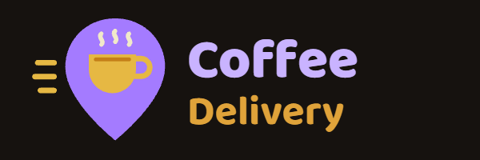
  &nbsp;&nbsp;
  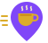
</p>

- **Ferramenta:** Claude (Anthropic), via Claude Code. A IA gerou a logo diretamente como **SVG vetorial**: arquivo leve, nítido em qualquer tamanho e editável.
- **Prompt:** *"Crie uma logo original para uma cafeteria com delivery chamada Coffee Delivery: um pin de localização roxo (#8047F8) contendo uma xícara amarela (#DBAC2C) com vapor, linhas de velocidade à esquerda indicando entrega rápida, e o nome 'Coffee Delivery' em Baloo 2. Gere em SVG, com versões para fundo claro e escuro e um ícone para favicon."*
- **Resultado:** `src/assets/logo-icon.svg` (símbolo/favicon), `src/assets/logo-light.svg` e `src/assets/logo-dark.svg` (variações para fundo claro e escuro). Também em `public/favicon.svg`.
- **Conceito:** o **pin** representa a entrega no endereço do cliente; a **xícara com vapor**, o café quente; as **linhas de velocidade**, a entrega rápida.
- **Paleta:** roxo `#8047F8` / `#4B2995` (marca e confiança), amarelo `#DBAC2C` / `#C47F17` (café e energia) e neutros quentes. No Dark Mode, as variações mais claras `#A47BFF` / `#E6B843` mantêm o contraste.
- **Tipografia:** Baloo 2 (títulos e marca) e Roboto (textos), como no Style Guide do Figma.
- **Por que esta proposta:** segue a paleta do protótipo e comunica as duas ideias do produto, café e entrega, em um único símbolo. Continua legível em 16 px (favicon) e 44 px (Header). Por ser vetorial, não tem imagens quebradas.
- **Curadoria:** o símbolo foi testado nos temas claro e escuro e em tamanhos reduzidos. No Header, o nome é texto real com as fontes do projeto (acessível e nítido).
- **Direitos de uso:** a logo é original, foi criada para este projeto acadêmico e não usa a marca nem o logotipo do protótipo. Pelos termos de uso da ferramenta, o conteúdo gerado pode ser usado pelo autor.

## 🖼️ Evidências

### Fluxo de compra (desktop, light)

| 1. Home | 2. CEP preenche o endereço | 3. Formulário completo | 4. Confirmação |
|---|---|---|---|
| 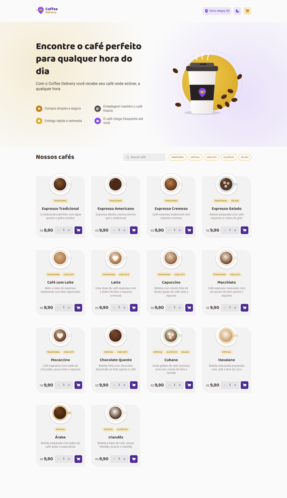 | 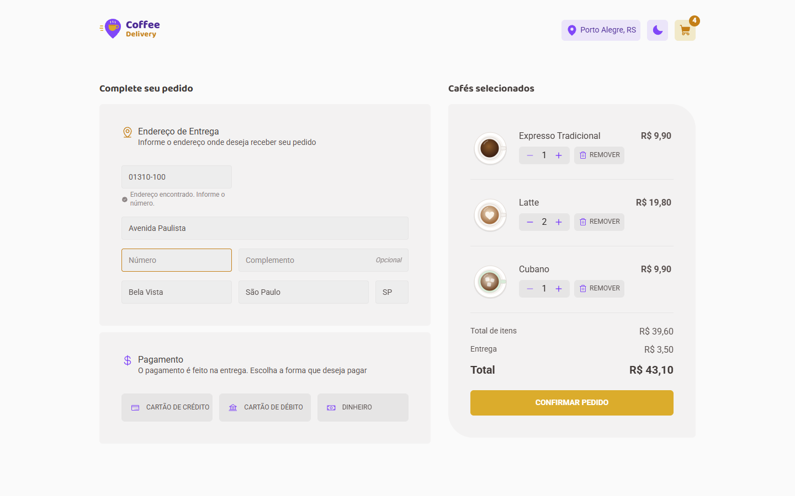 | 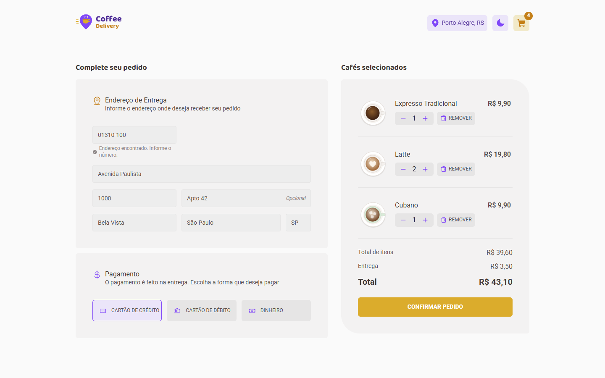 | 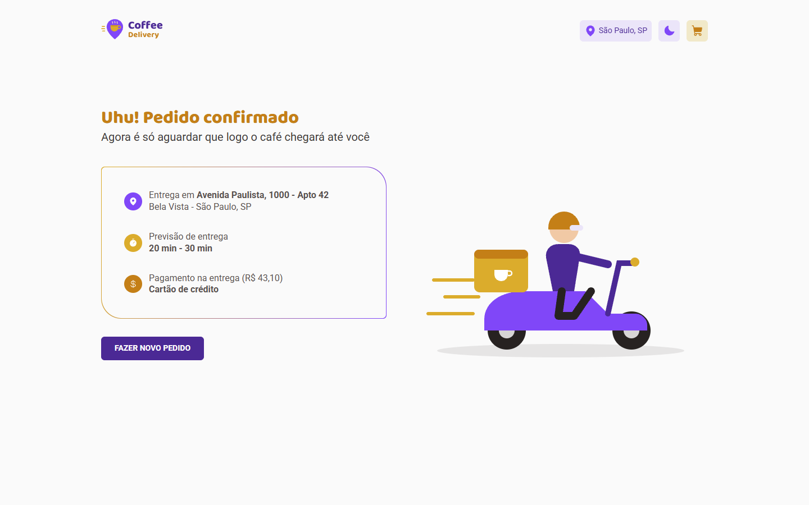 |

### Dark Mode (desktop)

| Home | Checkout | Sucesso |
|------|----------|---------|
|  |  | 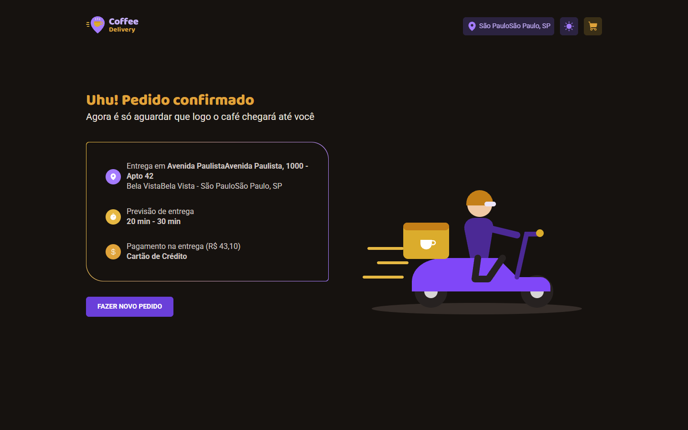 |

### Mobile (390 px) — light e dark

| Home | Checkout | Sucesso | Home dark | Checkout dark | Sucesso dark |
|---|---|---|---|---|---|
|  |  |  |  |  |  |

### Tablet (768 px) e tela pequena (320 px)

| Home tablet | Checkout tablet dark | Home 320 px | Checkout 320 px dark |
|---|---|---|---|
| 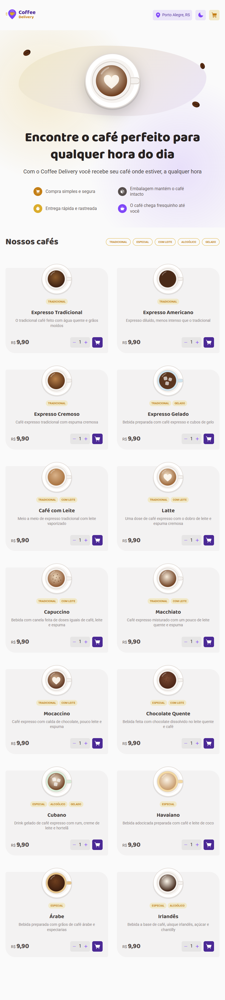 | 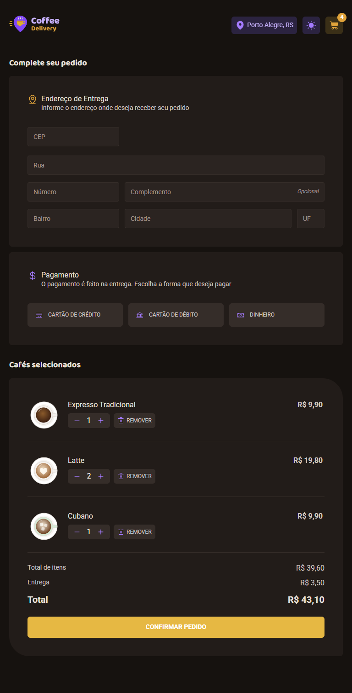 |  | 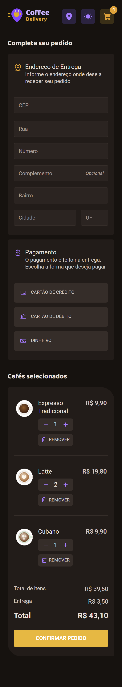 |

### Validações e estados

| Erros do formulário | CEP não encontrado | Carrinho vazio |
|---|---|---|
| 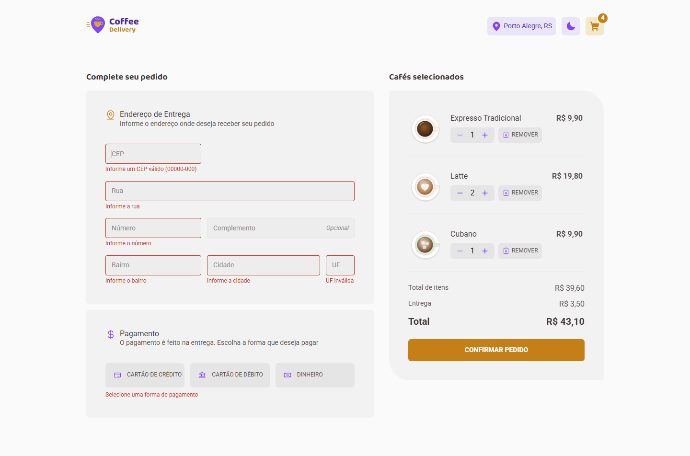 | 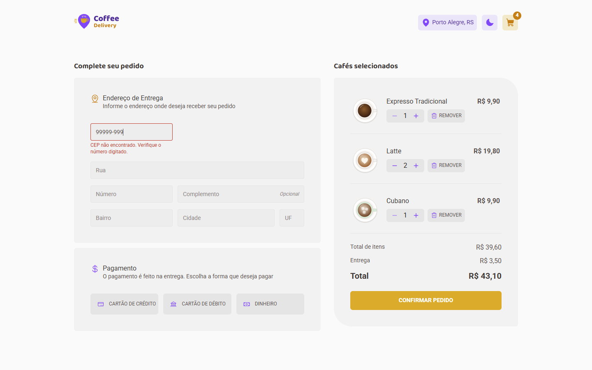 | 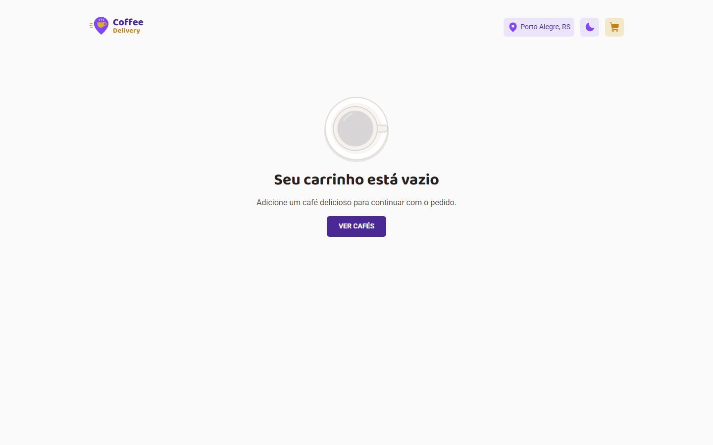 |

### Testes

```
 ✓ src/tests/viacep.test.ts (5 tests)
 ✓ src/tests/cartUtils.test.ts (5 tests)
 ✓ src/tests/cartReducer.test.ts (18 tests)
 ✓ src/tests/checkoutSchema.test.ts (10 tests)
 ✓ src/tests/format.test.ts (3 tests)
 ✓ src/tests/useLocalStorage.test.ts (3 tests)
 ✓ src/tests/app.test.tsx (16 tests)

 Test Files  7 passed (7)
      Tests  60 passed (60)
```

## 🤖 Uso de Inteligência Artificial

O **Claude Code (Anthropic)** foi usado em todas as fases: planejamento dos SPECs, leitura e comparação com o enunciado e o Figma, implementação em etapas, revisão de acessibilidade e contraste, depuração e testes. Seis interações estão registradas em [docs/AI_USAGE.md](docs/AI_USAGE.md), cada uma com prompt, objetivo, resposta resumida, decisão e evidência. As diretrizes para o agente estão em [AGENTS.md](AGENTS.md).

## 👤 Autor

**Luiz Felipe Rodrigues Silva**
